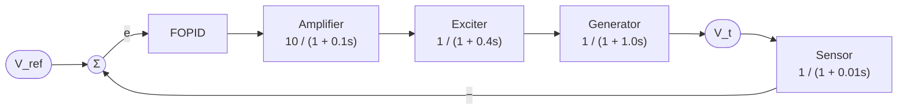

# Fast and Optimal Tuning of a Fractional-Order PID Controller for an AVR System using Smoothed Functional Algorithms

[](https://doi.org/10.1016/j.jestch.2022.101264)


MATLAB code accompanying the paper:

> RenHao Mok and Mohd Ashraf Ahmad, "Fast and optimal tuning of fractional order PID controller for AVR system based on memorizable-smoothed functional algorithm," *Engineering Science and Technology, an International Journal*, vol. 35, p. 101264, 2022. [https://doi.org/10.1016/j.jestch.2022.101264](https://doi.org/10.1016/j.jestch.2022.101264)

---

## Overview

Keeping the terminal voltage of a synchronous generator steady under uncertain load is the job of the **Automatic Voltage Regulator (AVR)**. A **Fractional-Order PID (FOPID)** controller adds two tunable orders (λ and μ) to the usual PID gains, which gives more freedom to shape the AVR response, but also leaves five parameters to tune.

Many population-based metaheuristics can tune a FOPID, but they need many cost-function evaluations per iteration. This repository implements a different route: **smoothed functional algorithm (SFA)** based tuners that estimate a gradient from only a pair of perturbed evaluations per iteration, so each iteration is cheap. Three SFA variants are provided:

| Variant | Idea |
|---|---|
| **NLSFA** | Norm-Limited SFA. The update vector is clipped element-wise so a single noisy gradient estimate cannot throw the parameters far away. |
| **MSFA** | Memorizable (memory-based) SFA. The best parameter set found so far is remembered, and the search continues from it. This removes the unstable convergence of the original SFA. |
| **CMSFA** | A variant of MSFA that also lets the two perturbed evaluation points compete for the stored best solution. |

The tuned controllers are evaluated on a standard AVR model through step-response and Bode (frequency-domain) analysis, and compared with FOPID gains reported in the literature for other optimizers (SCA, SA, CAS, PSO, NSGA-II, SFA).

---

## Repository contents

| File | Description |
|---|---|
| [`PIDAVR.m`](PIDAVR.m) | Plant and cost-function evaluator. Builds the FOPID + AVR closed loop, computes step-response metrics, the cost `J`, and stability margins. Optionally plots the step response and Bode diagram. |
| [`NLSFA_AVR.m`](NLSFA_AVR.m) | FOPID tuning with the **Norm-Limited SFA**. |
| [`MSFA_AVR.m`](MSFA_AVR.m) | FOPID tuning with the **Memorizable SFA**. |
| [`CMSFA_AVR.m`](CMSFA_AVR.m) | FOPID tuning with **Comparative-memory SFA**. |
| [`runGain.m`](runGain.m) | Compares fixed FOPID gain sets (literature results and the SFA-based results) in the time and frequency domains. |

---

## System model

### AVR loop



With $G(s) = C(s)\,G_A(s)\,G_E(s)\,G_G(s)$ and sensor $H(s)$, the closed loop is

$$T(s) = \frac{G(s)}{1 + G(s)H(s)}$$

### FOPID controller

$$C(s) = K_p + \frac{K_i}{s^{\lambda}} + K_d\, s^{\mu}$$

The five decision variables are `P = [Kp, Ki, Kd, lambda, mu]`. The fractional operators are approximated by a rational transfer function using the **Oustaloup recursive approximation** (order 5, frequency range 10⁻⁵ to 10⁵ rad/s).

### Cost function

The tuners minimize a time-domain criterion of the form proposed by Gaing, computed from the closed-loop step response (5 s horizon):

$$J = (1 - e^{-\beta})\big[(M_p - 1) + |y(t_{end}) - 1|\big] + e^{-\beta}\,(T_s - T_r), \qquad \beta = 1$$

where $M_p$ is the peak value, $T_s$ the 5 % settling time, $T_r$ the 10–90 % rise time, and $y(t_{end})$ the final sample of the step response.

---

## Algorithms

All three scripts share the same two-sided gradient estimate. At iteration $k$, with a random direction $\eta_k \in \{-1, +1\}^5$:

$$\theta_k^{\pm} = \mathrm{clip}\big(\theta_k \pm c_k \eta_k\big), \qquad
\hat g_k = \frac{J(\theta_k^{+}) - J(\theta_k^{-})}{2 c_k}\,\eta_k, \qquad
\theta_{k+1} = \mathrm{clip}\big(\theta_k - a_k \hat g_k\big)$$

with step sizes $a_k = 0.5/(k+1)$, $c_k = 0.05/(k+1)$, and all parameters bounded to $[0.001, 2]$.

They differ in how the new point is accepted:

| | NLSFA | MSFA | CMSFA |
|---|---|---|---|
| Update clipping | Yes, each component limited to ±δ (δ = 0.01) | No | No |
| Remembers best solution | No (always accepts the new iterate) | Yes | Yes |
| Candidates for the stored best | none | the updated point $\theta_{k+1}$ | $\theta_k^{+}$, $\theta_k^{-}$, and $\theta_{k+1}$ |
| Next iterate starts from | $\theta_{k+1}$ | best solution so far | best solution so far |
| Extra hyperparameter | δ | none | none |
| Convergence curve `Jf` | not necessarily monotone | non-increasing | non-increasing |

**Cost per run.** Each iteration calls `PIDAVR` three times (two perturbed points for the gradient, one for the updated point). With the default `Nc = 49` iterations plus the initial point, one run uses 1 + 3 × 49 = 148 cost evaluations.

---

## Requirements

- MATLAB with the **Control System Toolbox** (`tf`, `step`, `stepinfo`, `margin`).
- The **FOTF Toolbox** by Dingyu Xue, which provides the `fotf` class and `oustapp` used in `PIDAVR.m`. Add it to the MATLAB path before running anything.

---

## Usage

### 1. Tune the FOPID controller

Run any of the tuning scripts from the MATLAB command window:

```matlab
NLSFA_AVR    % norm-limited SFA
MSFA_AVR     % memorizable SFA
CMSFA_AVR    % CMSFA
```

Each script runs several independent trials (`rng default` is set at the top for repeatability), prints progress for every iteration, and finally re-evaluates the best parameter set found, producing:

- **Figure 1**: convergence curve (`Jf`) of the best trial.
- **Figure 11**: step response of the best controller.
- **Figure 12**: Bode diagram of the best closed loop.

The key output variables are listed below.

| Variable | Meaning |
|---|---|
| `Pbest` | Best parameter set `[Kp Ki Kd lambda mu]` over all trials |
| `bestRespond` | Table with `Mp%`, `Mp`, `Ts`, `Tr`, `J`, and `1/J` of the best controller |
| `Jgood`, `Pgood` | Final cost and parameters of each trial |
| `AvgJ`, `BestJgood`, `WorstJgood`, `stdJ` | Mean, best, worst, and standard deviation of `J` across trials |
| `treq` | Elapsed time per trial |

> **Number of trials.** The scripts loop over `iter = 1:5` by default for a quick run. The code comment marks where to raise this to 25 trials for the statistical comparison.

### 2. Compare controllers

```matlab
runGain
```

`runGain.m` evaluates nine fixed FOPID gain sets with `PIDAVR` and overlays their step responses (Figure 11) and Bode plots (Figure 12). Dashed lines are the literature methods, solid lines are the SFA family. It also fills:

- `bestRespond`: `Mp%`, `Mp-1` (overshoot as an absolute value, i.e. peak minus 1), `Ts`, `Tr`, `J`, `1/J` for each controller.
- `bodeData`: phase margin, crossover frequency, and delay margin for each controller.

### 3. Evaluate a single controller

```matlab
P = [Kp Ki Kd lambda mu];
[OS, Tr, Ts, Mp, J, bodeAnalysis] = PIDAVR(P, 'plotStepBode', "r", "-");
```

Pass `"0","0"` as the last two arguments to skip plotting (this is what the optimizers do). The second argument is ignored. `bodeAnalysis = [phase margin (deg), crossover frequency, delay margin]`.

---

## Reference gain sets (`runGain.m`)

| # | Method | Kp | Ki | Kd | λ | μ |
|---|---|---|---|---|---|---|
| 1 | SCA-FOPID | 1.4509 | 0.6567 | 0.3076 | 1.1442 | 1.2145 |
| 2 | SA-FOPID | 0.7837 | 0.5027 | 0.2307 | 1.0103 | 1.0727 |
| 3 | CAS-FOPID | 1.0537 | 0.4418 | 0.2510 | 1.0624 | 1.1122 |
| 4 | PSO-FOPID | 1.6264 | 0.2956 | 0.3226 | 1.3183 | 1.1980 |
| 5 | NSGA-II-FOPID | 0.8399 | 1.3359 | 0.3512 | 0.9147 | 0.7107 |
| 6 | SFA-FOPID | 1.2605 | 0.9855 | 0.3264 | 1.0578 | 1.1615 |
| 7 | NLSFA-FOPID | 1.1662 | 0.3779 | 0.2923 | 0.9648 | 1.1765 |
| 8 | MSFA-FOPID | 1.6889 | 0.0142 | 0.3847 | 1.4372 | 1.3339 |
| 9 | CMSFA-FOPID | 1.7251 | 0.0010 | 0.3905 | 1.4370 | 1.3414 |

Rows 1–5 are gains reported in the literature for other optimizers; rows 6–9 are from the SFA family. Plain SFA appears here only as a reference gain set (no separate tuning script is included).

---

## Configurable settings

These are set at the top of the tuning scripts.

| Setting | Default | Description |
|---|---|---|
| `lb`, `ub` | 0.001, 2 | Lower and upper bounds of all five parameters |
| `P(:,1)` | `[1 0.03 0.01 1 1]` | Initial parameter set |
| `Nc` | 49 | Number of iterations per trial |
| `ak` | `0.5/(k+1)` | Step size of the update |
| `ck` | `0.05/(k+1)` | Perturbation size |
| `delta` | 0.01 | Update clipping bound (NLSFA only) |
| `for iter=1:5` | 5 | Number of independent trials |
| `B` (in `PIDAVR.m`) | 1 | Weighting of the cost function |

---

## Results

<!-- Add figures here, for example:


-->

Run `runGain.m` to regenerate the step-response and Bode comparisons, and see the paper for the full analysis (step response, Bode, trajectory tracking, disturbance rejection, and parameter variation).

---

## Citation

If you use this code, please cite:

```bibtex
@article{mok2022fast,
  title   = {Fast and optimal tuning of fractional order {PID} controller for {AVR} system based on memorizable-smoothed functional algorithm},
  author  = {Mok, RenHao and Ahmad, Mohd Ashraf},
  journal = {Engineering Science and Technology, an International Journal},
  volume  = {35},
  pages   = {101264},
  year    = {2022},
  doi     = {10.1016/j.jestch.2022.101264}
}
```

---

## License

MIT License

Copyright (c) 2022 RenHao Mok, Mohd Ashraf Ahmad

Permission is hereby granted, free of charge, to any person obtaining a copy
of this software and associated documentation files (the "Software"), to deal
in the Software without restriction, including without limitation the rights
to use, copy, modify, merge, publish, distribute, sublicense, and/or sell
copies of the Software, and to permit persons to whom the Software is
furnished to do so, subject to the following conditions:

The above copyright notice and this permission notice shall be included in all
copies or substantial portions of the Software.

THE SOFTWARE IS PROVIDED "AS IS", WITHOUT WARRANTY OF ANY KIND, EXPRESS OR
IMPLIED, INCLUDING BUT NOT LIMITED TO THE WARRANTIES OF MERCHANTABILITY,
FITNESS FOR A PARTICULAR PURPOSE AND NONINFRINGEMENT. IN NO EVENT SHALL THE
AUTHORS OR COPYRIGHT HOLDERS BE LIABLE FOR ANY CLAIM, DAMAGES OR OTHER
LIABILITY, WHETHER IN AN ACTION OF CONTRACT, TORT OR OTHERWISE, ARISING FROM,
OUT OF OR IN CONNECTION WITH THE SOFTWARE OR THE USE OR OTHER DEALINGS IN THE
SOFTWARE.

## Contact

<!-- Add author affiliation / email / GitHub profile here. -->
